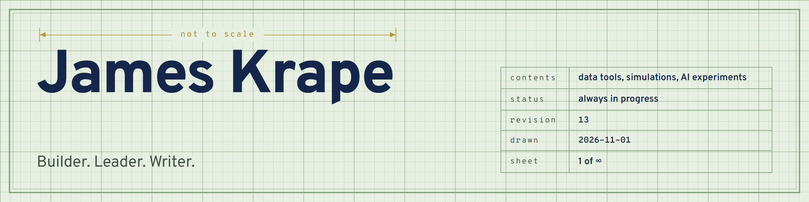
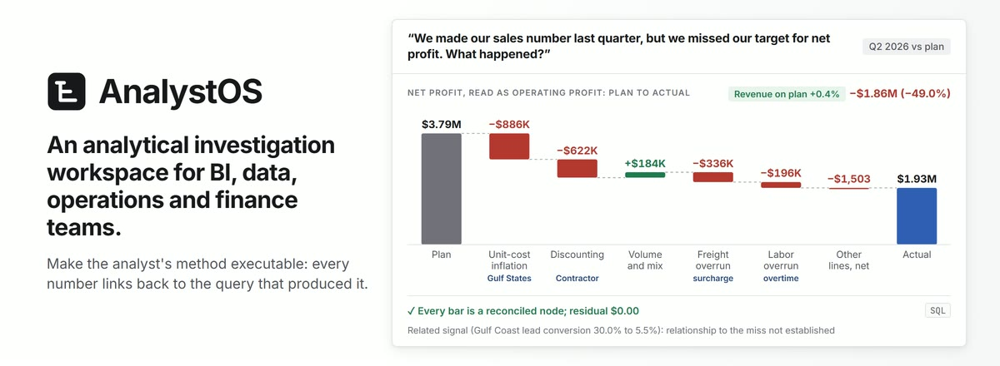
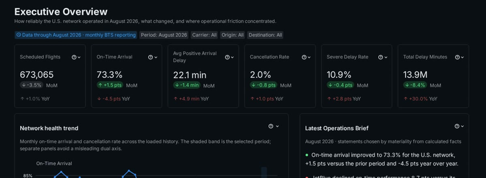
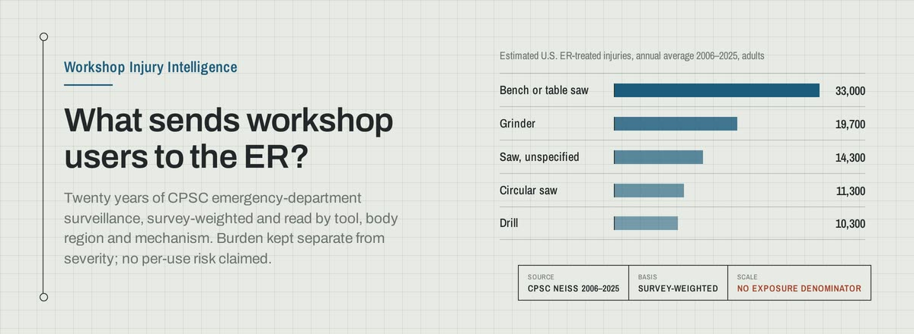
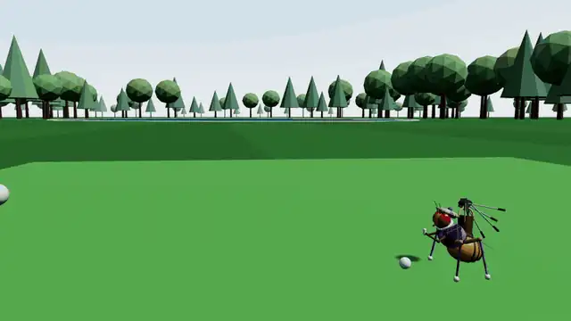
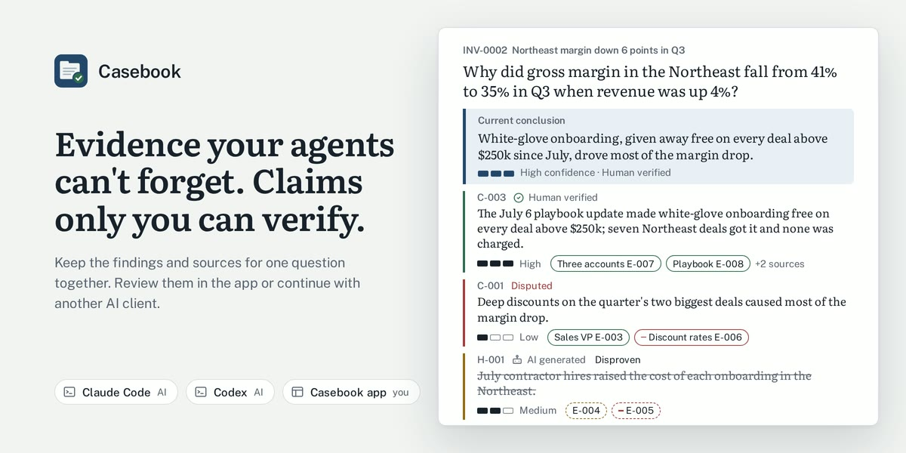
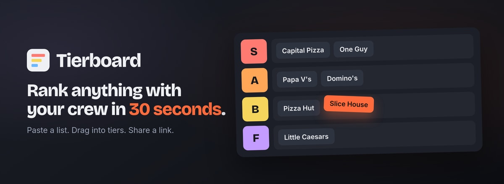
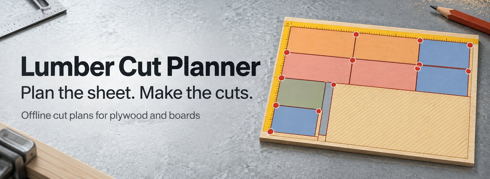
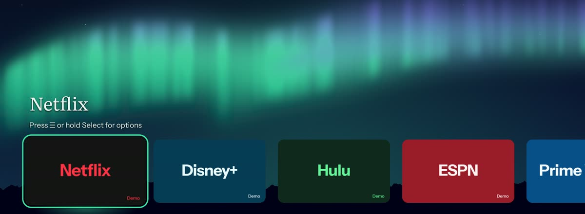
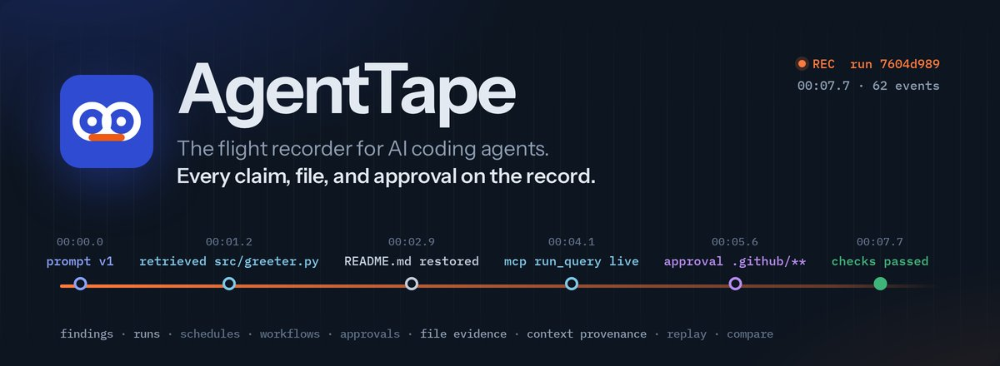

<!--
  Profile README for github.com/jameskbb. Hand-curated on purpose.

  Projects are grouped by theme, one "##" heading per group. To feature a
  project: copy one of the blocks into the group it belongs to. The most
  substantial projects get a full-width block that opens with a one-line
  hook in bold; smaller ones sit in a two-column grid, so keep each table at
  an even number of cells. Images live in assets/ (JPEG, ~1200px wide, and
  the same height across a grid row so it lines up). Add the project to the "Jump to" row
  under the intro as well. Jump links must use #user-content-<anchor>, because
  a plain #anchor does not scroll on the profile page. The anchor is the
  heading text, lowercased, with spaces turned into hyphens.

  Two regions are generated and must not be hand-edited: anything between
  BEGIN:repos / END:repos and BEGIN:writing / END:writing is overwritten by
  scripts/update-readme.mjs on every workflow run. Each region carries its
  own heading and is left empty when it has nothing to show, so the page
  never ends on a placeholder. A repo linked anywhere above the repos marker
  counts as featured and is dropped from the generated list, so promoting
  something is just a matter of writing a block for it. To keep a repo off
  the page entirely, add its name to .github/readme-ignore.txt.

  The banner is generated too: assets/src/banner.html is the layout, rendered
  through headless Chromium with a palette copied from jameskrape.com. See
  assets/src/render-banner.mjs.
-->

<picture>
  <source media="(prefers-color-scheme: dark)" srcset="assets/banner-dark.png">
  
</picture>

Data and analytics by day. The rest of the time I build data tools, AI experiments, things for the woodshop, and the occasional simulation that exists only because I wanted to know the answer.

The résumé lives on **[LinkedIn](https://www.linkedin.com/in/jameskrape)**.

**Jump to:** [AnalystOS](#user-content-analystos) · [FlightOps Intelligence](#user-content-flightops-intelligence) · [Workshop Injury Intelligence](#user-content-workshop-injury-intelligence) · [Fly Golf](#user-content-fly-golf) · [Blink Light](#user-content-blink-light) · [My homelab](#user-content-my-homelab) · [Casebook](#user-content-casebook) · [Tierboard](#user-content-tierboard) · [Lumber Cut Planner](#user-content-lumber-cut-planner) · [Hearth](#user-content-hearth) · [AgentTape](#user-content-agenttape)

## Data and analytics

### [AnalystOS](https://github.com/jameskbb/analystos)

**Ask why a number moved; get an answer where every figure links back to its SQL.**

A dashboard shows what happened. Working out why is still an analyst's afternoon. AnalystOS makes that method executable: ask "we made our sales number, but missed our target for net profit; what happened?" and it proposes a plan you can edit, runs it as SQL, and returns a tree of findings. In the made-up demo company, a $1.86M profit miss is attributed to supplier costs, contractor discounts, freight and overtime. It runs locally, and it needs no API key.

**[Source](https://github.com/jameskbb/analystos)**&emsp;`analytics` `semantic layer` `SQL` `Python` `TypeScript`

<table>
<tr>
<td width="50%" valign="top">

### [FlightOps Intelligence](https://github.com/jameskbb/airline-ops)

Three years of U.S. airline delays, from the whole network down to a single route. 36 months of DOT on-time reporting (23.0 million flights) you can actually interrogate, by route, carrier or delay cause.

**[Live demo](https://airline-ops.streamlit.app/)**&emsp;[Source](https://github.com/jameskbb/airline-ops)&emsp;`Streamlit` `DuckDB` `analytics` `Python`

</td>
<td width="50%" valign="top">

### [Workshop Injury Intelligence](https://github.com/jameskbb/shop-injury-intelligence)

What actually sends people from the workshop to the ER. Twenty years of U.S. emergency-department data, by tool, body region and how it happened. These are estimated injury counts, not the odds of getting hurt.

**[Live demo](https://shop-injury-intelligence.streamlit.app/)**&emsp;[Source](https://github.com/jameskbb/shop-injury-intelligence)&emsp;`survey statistics` `Streamlit` `DuckDB` `Python`

</td>
</tr>
</table>

## Experiments

### [Fly Golf](https://github.com/jameskbb/fly-golf)

**What happens when you hand a fruit fly's brain a golf bag.**

Fly Golf takes the reconstructed wiring of a real male fruit fly's brain and nerve cord (166,700 neurons, 25.6 million connections), simulates it spike by spike, and puts it on a 3D golf course. Club, aim and power are read out of its neural activity. It has broken 100 in 13 of 46 rounds, with a best of 88.

**[Recorded demo](https://jameskbb.github.io/fly-golf/)**&emsp;[Source](https://github.com/jameskbb/fly-golf)&emsp;`connectome` `spiking neural sim` `Three.js` `Python`

<table>
<tr>
<td width="50%" valign="top">

### [Blink Light](https://github.com/jameskbb/blink-light)

A USB light that knows what my day is doing. It glows red while I'm in a meeting, flashes gold two minutes before standup, breathes blue when an AI coding agent finishes, and thumps orange-red when a GitHub Actions run I started fails.

**[Source](https://github.com/jameskbb/blink-light)**&emsp;`Python` `hardware` `AI agents`

</td>
<td width="50%" valign="top">

### [My homelab](https://github.com/jameskbb/homelab-public)

A retired desktop running Proxmox: everyday apps, game servers for friends, and a sandbox for experiments. Written as a guide for someone who has never run a server, backups and restores included.

**[Source](https://github.com/jameskbb/homelab-public)**&emsp;`Proxmox` `self-hosting` `guide`

</td>
</tr>
</table>

## Everyday tools

### [Casebook](https://github.com/jameskbb/casebook)

**Evidence your agents can't forget, claims only you can verify.**

AI findings become a case you can explain and fact-check later, across sessions and AI clients, with everything kept on your own computer.

**[Download](https://github.com/jameskbb/casebook/releases)**&emsp;[Source](https://github.com/jameskbb/casebook)&emsp;`Go` `MCP` `AI agents` `desktop app`

<table>
<tr>
<td width="50%" valign="top">

### [Tierboard](https://github.com/jameskbb/tierboard)

Someone at lunch says "let's rank every pizza place in town." Paste a list, drag it into tiers, share a link: fast enough to finish before the conversation moves on. Voting, presentation mode and PNG export stay a keystroke away. No login, no backend.

**[Live demo](https://jameskbb.github.io/tierboard/)**&emsp;[Source](https://github.com/jameskbb/tierboard)&emsp;`TypeScript` `no backend`

</td>
<td width="50%" valign="top">

### [Lumber Cut Planner](https://github.com/jameskbb/lumber-cut-planner)

Tell it the plywood and boards you have and the parts you need. It lays out cuts a table saw can actually make, edge to edge with the blade kerf taken out, numbers them in the order you'll make them, and points out the offcuts worth keeping. It keeps working offline once loaded.

**[Live demo](https://jameskbb.github.io/lumber-cut-planner/)**&emsp;[Source](https://github.com/jameskbb/lumber-cut-planner)&emsp;`woodworking` `cut optimization` `offline web app`

</td>
</tr>
<tr>
<td width="50%" valign="top">

### [Hearth](https://github.com/jameskbb/hearth)

A quiet, colorful home screen for Fire TV and Android TV, with animated scenes and remote-first navigation. Your apps in your order, and no ads, recommendations, accounts or analytics.

**[Source](https://github.com/jameskbb/hearth)**&emsp;`Kotlin` `Android TV` `Fire TV`

</td>
<td width="50%" valign="top">

### [AgentTape](https://github.com/jameskbb/agent-tape)

Did your coding agent really read the lines it cites? Agents record findings with their evidence, and AgentTape checks each citation against its own recording of the run. A matching quote shows the lines were in what the agent read, not that its conclusion is right. It runs locally and checks Claude Code findings today. Version 0.1.0, unreleased.

**[Source](https://github.com/jameskbb/agent-tape)**&emsp;`Python` `AI agents` `MCP` `Claude Code`

</td>
</tr>
</table>

<!-- BEGIN:repos -->
## Elsewhere on GitHub

- **[agent-tape](https://github.com/jameskbb/agent-tape)**: Trust but verify AI coding agents: findings cite evidence, and AgentTape checks each citation against its own recording of the run. Local-first. Python · updated 2026-11-02
- **[email-signature](https://github.com/jameskbb/email-signature)**: Create email signatures with hosted images, contact links, live preview, and HTML export. No build step. JavaScript · updated 2026-11-02
<!-- END:repos -->

<!-- BEGIN:writing -->
<!-- END:writing -->
